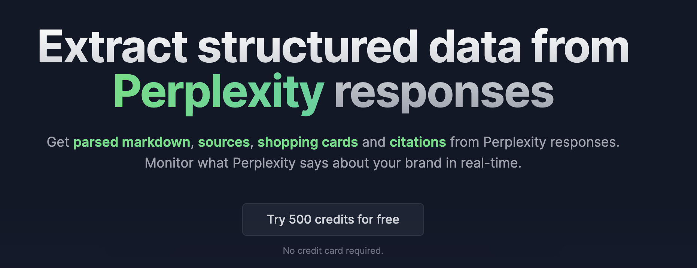

# Perplexity Scraper

[](https://cloro.dev/perplexity/?utm_source=github)

[](https://cloro.dev/)

The [Perplexity scraper](https://cloro.dev/perplexity/?utm_source=github) by cloro is an API that returns the Perplexity answers and sources its UI shows, as structured JSON: the answer text and markdown, every cited web source with position and label, the related queries Perplexity suggests, and the search-model queries it ran to build the answer.

> **Perplexity scraper is discontinued.** Perplexity blocks access for logged-out sessions. Requests to `/v1/monitor/perplexity` and async tasks with `taskType` `PERPLEXITY` fail with a `400` (`MODEL_UNAVAILABLE`) and cost no credits. The [providers guide](https://cloro.dev/docs/guides/providers#unsupported-providers) has the details.

## How do you scrape Perplexity?

1. Get an API key at [cloro.dev](https://cloro.dev/?utm_source=github&utm_medium=readme).
2. POST a prompt to `https://api.cloro.dev/v1/monitor/perplexity`.
3. Read the parsed fields from the JSON response.

Perplexity's value for monitoring is that it cites heavily and in the open, so the source list is a direct read on which domains the model trusts for a question. The scraper returns that list rather than a screenshot, so you can join it to your own data.

### Request sample (Python)

```python
import requests

payload = {
    'prompt': 'best SERP API for rank tracking',
    'country': 'US',
    'include': {'markdown': True},
}

response = requests.post(
    'https://api.cloro.dev/v1/monitor/perplexity',
    headers={'Authorization': 'Bearer YOUR_API_KEY'},
    json=payload,
)

print(response.json())
```

### Request sample (cURL)

```bash
curl -X POST https://api.cloro.dev/v1/monitor/perplexity \
  -H "Authorization: Bearer YOUR_API_KEY" \
  -H "Content-Type: application/json" \
  -d '{"prompt": "best SERP API for rank tracking", "country": "US"}'
```

Node.js and async/webhook examples are in the [endpoint documentation](https://cloro.dev/docs/api-reference/endpoint/monitor-perplexity).

### Request parameters

| Parameter | Description | Default |
| --- | --- | --- |
| `prompt`\* | The query or question (1-10,000 characters) | – |
| `country`\* | Country code for localized results (`US`, `GB`, `DE`) | – |
| `state` | US state code for finer localization | – |
| `include.markdown` | Return the answer as Markdown | `false` |
| `include.html` | Return a URL to the full HTML (expires after 24h) | `false` |
| `include.rawResponse` | Return the unparsed upstream payload | `false` |

\* Required

## What data does the Perplexity scraper return?

```json
{
  "success": true,
  "result": {
    "text": "The strongest options for rank tracking are...",
    "sources": [
      { "position": 1, "url": "https://example.com/serp-apis", "label": "Example Review", "description": "Comparison of SERP API providers..." }
    ],
    "related_queries": ["serp api pricing comparison", "rank tracking api free tier"],
    "search_model_queries": ["best serp api 2026", "serp api rank tracking accuracy"],
    "markdown": "The strongest options are **[Example](https://example.com)**..."
  }
}
```

Alongside `text` and `markdown`:

1. **`sources`**: every cited URL with position, label and description. Position matters: a source cited first is weighted differently by readers than one cited eighth.
2. **`related_queries`**: the follow-up questions Perplexity offers, which map the neighbourhood of a topic.
3. **`search_model_queries`**: the searches Perplexity actually ran. These differ from the user prompt and are the closest thing to seeing the model's retrieval step.
4. **`citationPills`**: inline citation chips where the answer carries them.
5. **`videos`**, **`images`**, **`places`**, **`hotels`** and **`shopping_cards`**: media, local and product blocks, filled when the answer carries them.
6. **`rawResponse`**: the unparsed upstream payload.

Full field-level schemas are in the [endpoint reference](https://cloro.dev/docs/api-reference/endpoint/monitor-perplexity).

## Use cases

- **Citation tracking**: which domains Perplexity reaches for on your category's questions.
- **Brand monitoring**: whether you are named, and in what position among the sources.
- **Content gap analysis**: the `search_model_queries` show what the model looked for and did not find on your site.
- **Competitive research**: the source list on a buyer question is a ranked list of who is winning that question.

## FAQ

### Is there an API that returns Perplexity's UI answer rather than its model API?

Not from cloro any more. The cloro scraper returned what the Perplexity product shows a user, including the cited source list and the related queries, until Perplexity blocked logged-out sessions. The official Perplexity API answers a prompt with a model and does not expose them the same way.

### What are search-model queries?

The searches Perplexity ran internally to answer your prompt, rather than the prompt itself. They are the most actionable field in the response, because they are the terms your content would have to match to be retrieved.

### Is scraping Perplexity allowed?

cloro reads publicly visible answers. Check your own jurisdiction and terms, and do not use the output to reproduce copyrighted content wholesale.

### Does it support geo-targeting?

Yes, via `country` and `state`. Answers and cited sources differ by region on local and commercial questions.

## Learn more

- **Endpoint reference:** [cloro.dev/docs](https://cloro.dev/docs/api-reference/endpoint/monitor-perplexity)
- **Product page:** [cloro.dev/perplexity](https://cloro.dev/perplexity/)

## Other cloro scrapers

[AI Mode](https://cloro.dev/ai-mode/) · [AI Overview](https://cloro.dev/ai-overview/) · [ChatGPT](https://cloro.dev/chatgpt/) · [Gemini](https://cloro.dev/gemini/) · [Google Search](https://cloro.dev/google-search/) · [Google News](https://cloro.dev/google-news/)

## Contact us

Questions or support: [ask the docs AI assistant](https://cloro.dev/docs/?assistant).
